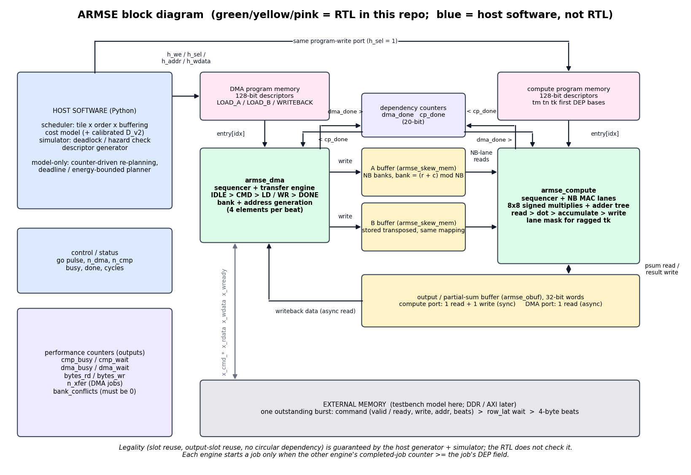

# ARMSE architecture specification

Status legend: **[model]** = Python, executed and tested here. **[RTL]** = Verilog written, *not compiled or simulated here*. **[host]** = host-side software.

More diagrams (Mermaid, rendered on GitHub): `docs/ARCHITECTURE_DIAGRAM.md`. Flow figure: `docs/img/armse_flow.png`.

## 1. What is hardware, what is software, what is a model

| Part | Kind | File |
|---|---|---|
| Skewed banked A/B buffers, output buffer, DMA/transfer engine, compute engine, two descriptor sequencers, counters | **[RTL]** | `rtl/*.v` |
| Tile/loop/buffer scheduler (candidate enumeration, cost function, legality) and program (descriptor) generation | **[host]** | `armse/scheduler.py`, `armse/schedule.py` |
| Event simulator, hazard/deadlock checker, closed-form estimator, bank/energy analysis | **[model]** | `armse/sim.py`, `analytic.py`, `banks.py`, `energy.py` |

The adaptive scheduler is host software that emits a static descriptor program. That is a compiler technique, not a physical memory architecture; the physical contribution is the decoupled two-counter execution, the skewed bank mapping and the double-buffered buffer/DMA structure that make such programs cheap to run and safe to validate.

## 2. Memory hierarchy and assumptions

* **External memory** (not modelled as HBM/DDR): one outstanding burst, `row_lat` cycles from command to first beat, one beat per cycle afterwards, `bus_bytes` per beat (RTL: 4). Rows may start at any byte address (idealised; real buses need realignment, not modelled). Theoretical = sustained bandwidth in this model; on a real board the *sustained* value must be measured and substituted.
* **On-chip**: A buffer and B buffer, each `NB` byte-wide banks x `DEPTH` words (1 write + 1 read port per bank); output buffer of 32-bit words (compute port: 1R+1W synchronous; DMA port: 1 asynchronous read). All slots (1 or 2) live inside the fixed physical depth: a slot is `depth/nbuf` words.
* **Tile geometry rules**: A tile (tm x tk) needs `tm*ceil(tk/NB)` words per bank; B tile needs `tn*ceil(tk/NB)`; output tile `tm*tn` words. Tile fields are 8-bit (<=255); counters/indices are 20-bit.
* **Data types**: INT8 operands, INT32 accumulation (two's-complement wrap, same as the int64->int32 reference). No requantisation, no sparsity.
* **Coherency**: none needed (single writer per buffer slot; ownership enforced by dependency counters). **Reset**: `rst` clears sequencers and counters; `go` clears counters and starts. Reset during active operation is *not* verified.
* **Errors**: the RTL assumes a legal program. Illegal schedules are rejected by the host (`violations`, `check_hazards`, deadlock detection); the RTL has no illegal-address trap (listed as future work).

## 3. Bank mapping (skew)

Element (row r, col c) of a buffer is stored in bank `(r + c) mod NB`, word `r*stride + c/NB`, `stride = ceil(tk/NB)`. For the A tile r=i (output row), c=k. For the B tile r=j (output column), c=k, i.e. B is stored transposed.
* compute reads NB consecutive k of one row -> NB distinct banks (then de-rotated by `r mod NB`);
* DMA writes 4 consecutive elements of one external row: for A they are consecutive k, for B consecutive j; both hit 4 distinct banks (NB >= 4).
Naive row-major B ([k][j], stride tn) serialises lane reads by `gcd(tn, NB)`; this is quantified in `results/REPORT.md` section 7 and is the reason the mapping exists.

## 4. Descriptor programs (decoupled access/execute)

Two in-order programs, each entry waits on one counter of the *other* engine:

* DMA entry: `TYPE{LOAD_A,LOAD_B,WRITEBACK}, DEP, ROWS, COLS, EXT_ADDR, EXT_STRIDE, BASE, STRIDE`: starts when `cp_done >= DEP`.
* Compute entry: `TM, TN, TK, FIRST, DEP, ABASE, BBASE, OBASE`: starts when `dma_done >= DEP`.

Field layout is generated into `rtl/armse_fields.vh` from `armse/rtlexport.py` (round-trip tested).
Single vs double buffering is *only* a different set of DEP values: slot reuse = "last user of the slot has completed"; output slot reuse = "the writeback of the tile that previously owned the slot has completed". Operand retention (reuse) falls out of the loop nest: a load is skipped when consecutive iterations use the same tile id. The loop-nest reuse rule is: `nk>1`: A is traversed `nn` times and B `nm` times; `nk==1`: MN order loads A once and B `nm` times (`nn>1`), NM order is symmetric.

## 5. Scheduler (deterministic) and cost function

1. validate operator / dims (empty workloads -> empty program; unsupported op -> `UnsupportedOp`);
2. enumerate candidates: tile sizes per dimension (powers of two, balanced splits `ceil(D/n)`, lane multiples for K, full dimension), 2 loop orders, 4 buffering pairs;
3. reject candidates that violate slot capacity, field widths or program length;
4. cost = estimated cycles = exact DMA-busy and compute-busy sums combined with an overlap approximation (`armse/analytic.py`); ties broken on bytes, buffering, order, tile size (fully deterministic);
5. fallback: smallest legal 1x1xK tile; `NoFitError` if even that does not fit;
6. `D_feedback` simulates the top-8 candidates and keeps the best measured one;
7. every generated program is checked by the simulator for deadlock and buffer hazards.
Predicted vs observed behaviour is compared in `results/REPORT.md` section 3.

## 6. Timing contract between model and RTL (hand-derived; cross-checked by the cycle-level transcription `armse/rtlmodel.py`, NOT by an HDL simulator)

| Quantity | Formula | Origin |
|---|---|---|
| DMA job duration | `job_ovh + rows*(row_lat+1+beats)`, `job_ovh=2`, loads `beats=ceil(cols/4)`, writeback `beats=cols` | IDLE->CMD (1), per row: 1 cmd + `row_lat` wait + beats, DONE (1), counter visible +1 |
| Compute job duration | `tm*tn*ceil(tk/NB) + 4` | RUN issue cycles, then D1, D2, DONE, counter visible |
| Requantised writeback job | `2 + rows*(cols + 3*ceil(cols/4) + 1 + max(0, row_lat - n1 - 2))`, `n1 = min(4, cols)` | per beat: n element issues + 2 post-unit cycles + 1 transfer; first beat also waits for the memory latency (`sim.wb8_row_cycles`; checked against the RTL transcription) |
| First start | cycle 1 after `go` (go = cycle 0) | `start_off = 1` |
| Total | cycle index at which both counters reach their targets | `cycles` output |

Counter definition note: the RTL `busy` counters count cycles spent outside IDLE, i.e. model duration minus one per job (the start cycle and the visibility cycle overlap); `EXP_*_BUSY` in the generated `meta.vh` already accounts for this.

The RTL testbench prints `measured` vs `model` for every case. Any constant that disagrees is a calibration parameter of `HwConfig` (`job_ovh`, `cmp_ovh`, `start_off`, `row_lat`): update it and rerun the Python benchmark; do not treat a cycle mismatch as proof either side is wrong until the delta is explained.

## 7. Counters (hardware) and metrics (model)

RTL counters: total cycles, compute-busy, compute-wait (waiting on DMA), DMA-busy, DMA-wait, bytes read, bytes written, transfers, bank conflicts. Model additionally derives stall attribution, DMA time split (sync / latency / data), sustained bandwidth, buffer utilisation, MAC utilisation, descriptor-program size.

## 8. Known limitations (read before quoting results)

* Unrolled descriptor programs: program memory grows with iteration count (see `program_bytes` in the report). A hardware loop generator is not implemented.
* Conv is lowered by im2col with the lowered matrix counted in traffic (no sliding-window reuse); attention = two GEMMs, no softmax; MLP = GEMM chain. Fusion of two-GEMM chains is implemented in the MODEL ONLY (`armse/fused.py`: resident-A and no-writeback program modes, requantisation cost per output tile); the RTL has no requantiser and no independent stride field for a resident operand, so fused programs cannot run on it.
* Buffer partitioning between A/B/O is fixed at design time (per-buffer capacity), not dynamically re-partitioned.
* Single DMA channel, single outstanding burst, idealised unaligned access, no bus errors.
* Level-2 energy uses illustrative constants; no measured energy.
* No synthesis was run: LUT/FF/DSP/BRAM mapping, Fmax and timing closure are unknown.

## 9. Energy evidence levels

L1 activity (exact counts) and L2 analytical (stated constants, sensitivity on external-memory energy) are produced. L3 measured energy is not. A reduction in bytes or toggles is never labelled measured energy.
