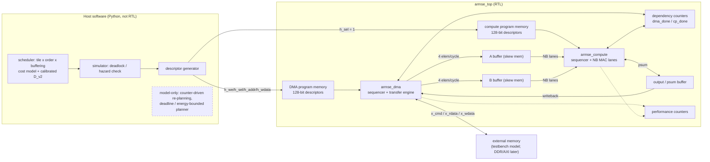
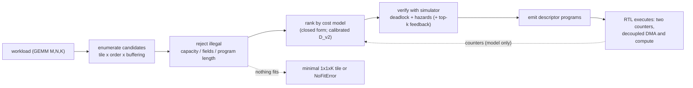
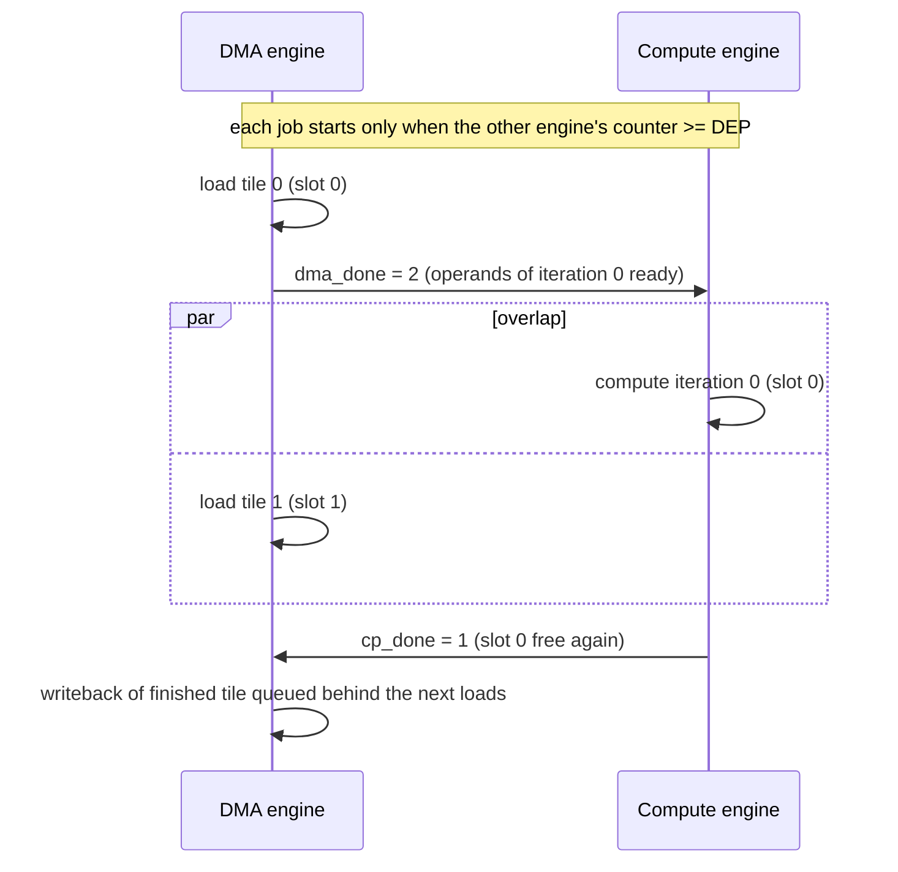

# ARMSE diagrams

PNG versions (for slides/reports): `docs/img/armse_block_diagram.png`, `docs/img/armse_flow.png` (regenerate with `python tools/draw_diagrams.py`).
The Mermaid versions below render directly on GitHub. They describe the RTL in `rtl/` and the host software in `armse/`; the green/yellow
blocks exist as Verilog, the blue ones are host software (Python), and the dashed items are model-only (no RTL).

## 1. Block diagram

## 2. Scheduling and execution flow

## 3. Double-buffered execution (timeline idea)

