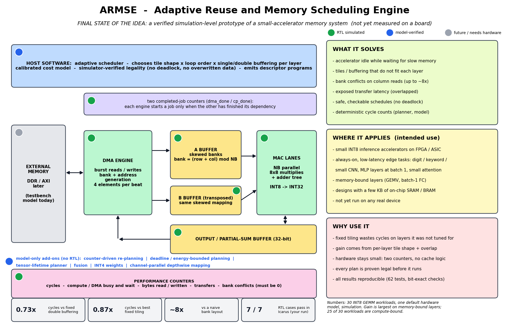

# ARMSE: final state of the idea (one-page summary)

**Status in one sentence:** a verified, simulation-level prototype of a small-accelerator memory system. The memory hardware (RTL) passes its 7 fixed tests in Icarus Verilog, and everything else is verified in a Python model. Nothing has been synthesized, run on a board, or measured for power.

## What it is
A planner plus a small piece of hardware that keeps an INT8 AI accelerator fed with data.
* **Host software** chooses, per layer, how to cut the matrices into tiles, in what loop order, and whether to load the next tile while computing the current one. It proves each plan is legal (no deadlock, no data overwritten while in use) before it is run.
* **Hardware (Verilog)** executes the plan with two engines, one that moves data and one that computes, kept in step by two completed-job counters. The on-chip buffers are split into banks with a skewed layout so many values can be read in one cycle without collisions. Performance counters report what happened.

## What it solves (measured in simulation, 30 INT8 workloads, one default hardware model)
| Problem | Result |
|---|---|
| Accelerator idle, waiting for memory | 0.733x the cycles of a fixed double-buffered design; 0.869x those of the best fixed tiling (29 wins, 1 loss) |
| Fixed tiles that do not suit each layer | per-layer tile shape is where most of the gain comes from (ablation: 0.749 vs 0.844 without it) |
| Bank conflicts on column reads | skewed layout removes them; a naive layout can be up to ~8x slower |
| Needing a simulator to plan | a calibrated estimator reaches 0.870x without simulating (held-out evaluation) |
| Different hardware settings | never slower than the best fixed tiling across 27 hardware configurations (0.536-0.973x) |

## Where it applies (intended use, not yet deployed anywhere)
Small INT8 inference accelerators on FPGA or ASIC with a few KB of on-chip memory: always-on, low-latency edge tasks such as digit or keyword recognition, small CNNs, fully connected layers at batch 1, and small attention blocks. The gain is largest on memory-bound layers (GEMV, batch-1 fully connected).

## Why use it
* A fixed tiling is tuned for one shape and wastes cycles on others; choosing per layer recovers them.
* The hardware stays small (two counters, no cache machinery) and the same hardware runs any legal plan.
* Plans are proven legal and results are reproducible (62 tests, bit-exact against an independent reference; RTL cycles match the model on every visible case).

## What it does not solve
* 25 of 30 workloads are compute-bound; memory scheduling gives little there, and the advantage shrinks with larger buffers (0.963x at 4x buffers).
* It does not reduce model size, handle sparsity, or lower power; there is no energy measurement (the energy figures are illustrative).
* Fusion of layers mostly loses at 2-32 KB of on-chip memory; INT4 weights save bytes in the model but accuracy is not evaluated.

## Evidence levels (nothing is mixed)
| Level | What it covers |
|---|---|
| RTL simulated in Icarus (your run) | skewed banked buffers, DMA, compute engine, counters; 7 fixed cases; 40 random cases still to run |
| Model-verified (Python, 62 tests) | scheduler, cost model, calibrated estimator, baselines, hardware sweep |
| Model only, no RTL | counter-driven re-planning, deadline / energy planning, lifetime planner, fusion, INT4, channel-parallel depthwise |
| Not done | synthesis, board, real DDR/AXI timing, power measurement, literature-verified novelty check, integration with the existing accelerator |

## Is it unique?
Not established. Choosing tiles with a cost model is already done in published mapping tools (from recall, unverified), and double buffering and skewed banking are known techniques. The defensible contribution so far is the verified, reproducible package with strong baselines and honest negative results. See `docs/RESEARCH_DECISION.md` and run `docs/LITERATURE_SEARCH_PROMPT.md` in a search-enabled chat to settle it.

## What a real device still needs
A real memory interface (AXI to DDR) with measured latency and bandwidth; registered-read (block-RAM) memories; a model-to-descriptors compiler and CPU driver; hardware error checks and a watchdog; synthesis and board measurements; integration with your accelerator. Details: `docs/BOARD_GUIDE.md`, `docs/INTERFACE_SPEC.md`, `docs/RISK_REGISTER.md`.
